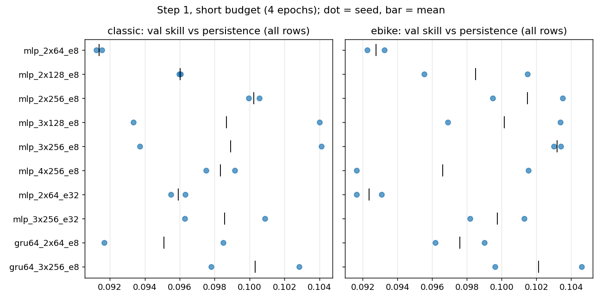
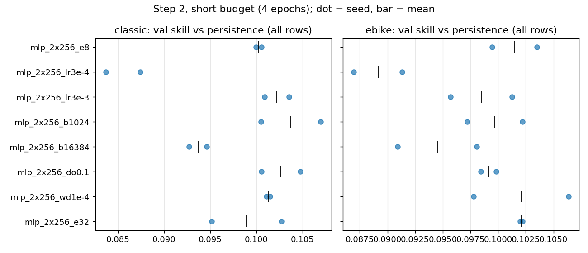
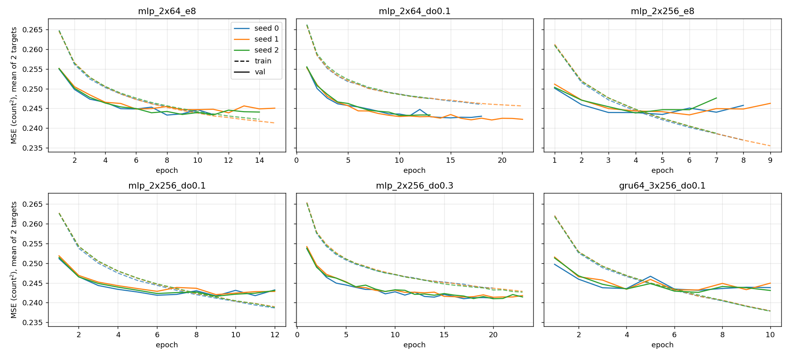
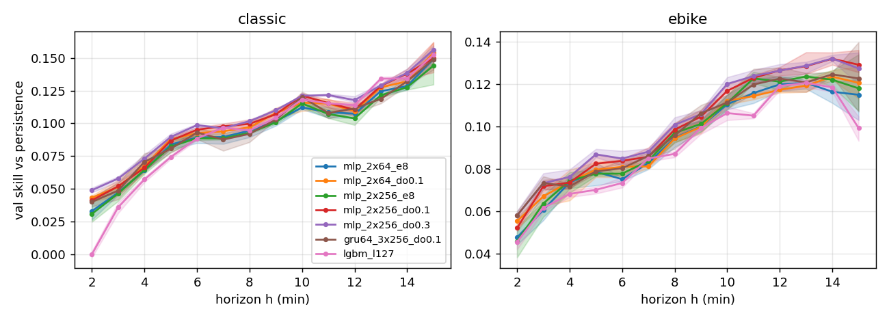
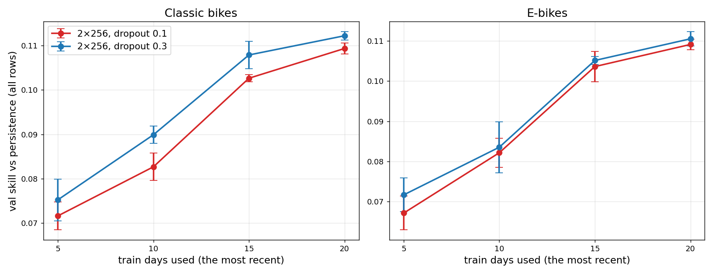

# Model search (Nov 11–12, 2026; model choice on val only)

The search covered the architecture family, then the training hyperparameters. It ran on the team table data-v1 with the weather fix (team repo `main` 969473f). Every run used train only for fitting, and val for early stopping and selection; the search never read the test rows. The one test score, taken afterwards on Nov 12, is in `MEETING_2026-11-12.md` (Test result) and `test_team_summary.csv` (`42_test_score.py`). Skill is 1 − MSE_model / MSE_persistence on val, given as classic / e-bike over all rows. The low rows (count at t ≤ 2) are given separately. "± sd" is the sample sd over seeds 0–2, or seeds 0–1 where stated.

Every number comes from a script in `src/` and its output in `reports/tables/`. `37_model_search.py` logs the runs to `model_search_runs.csv` (86 runs, 30 configurations, including Step 6), with curves in `model_search_curves.csv` and per-horizon skill in `model_search_by_horizon.csv`. `38_search_report.py` writes the summaries `model_search_summary.csv` and `model_search_by_horizon_summary.csv`. `39_val_noise.py` writes the val-sampling noise to `val_noise_gap.csv`, `val_noise_by_day.csv` and `val_noise_optimism.csv`. `notebooks/model_search_trace.ipynb` prints each number below from its file.

This version was revised on Nov 12 after six independent reviews of commit 0ca8d64. They found no leakage, and the choice stands. What changed is listed at the end.

## Setup

**Data.** the team table `data/processed/training_table.parquet`, built by the team repo's `notebooks/build_dataset.ipynb` at `main` 969473f, SHA-1 263bb791129bccf2073b1c4e827acf82eafeb96e, checked before the runs. Train has 7,525,845 rows (Sep 29 – Oct 18). Val has 2,083,617 rows (Oct 19–23, Monday to Friday) at 1,071 stations.

**Model and training.** Inputs, output and loss are those of the Nov 10 MLP (`src/33_train_mlp.py --data team`). The inputs are the table's 20 documented numeric inputs, including h, plus the station through an embedding. The model predicts the change of each count, and the loss is the MSE of the count. Defaults: Adam at learning rate 1e-3, batch 4096, embedding size 8, no dropout or weight decay.

**Early stopping and budgets.** Early stopping uses the mean val MSE of the two targets, which classic bikes dominate (persistence MSE 0.393 against 0.150 for e-bikes, `mlp_team_val.csv`). "Short" means 4 epochs without early stopping, keeping the best of the 4 val epochs; it was used to rank candidates in Steps 1–2. "Full" means up to 30 epochs with patience 3, keeping the epoch with the lowest val MSE. No full run reached the cap; the longest ran 23 epochs.

**Hardware.** All nets ran on CPU with 6 threads (PyTorch 2.13). LightGBM seed 0 used 4 threads. Seeds change the initial weights, the batch order and the dropout masks.

**Reproduction check.** The base configuration (2 × 64, full budget, seed 0) reproduces the Nov 10 run exactly: 0.1056 / 0.0988 (`s3_mlp_2x64_e8_full_seed0`; `mlp_team_val.csv`). Its three seeds give 0.103 ± 0.003 / 0.102 ± 0.003, the Nov 10 values. Twelve runs were retrained to save their val predictions: base, chosen, dropout 0.3 and LightGBM, seeds 0–2 each. Each retrain gave its logged val skill to 1e-6 (`37_model_search.py --save`).

## Step 1: architecture family (short budget, seeds 0–1)

Widening the base MLP from 2 × 64 to 2 × 256 raised the skill at 4 epochs from 0.091 / 0.093 to 0.100 / 0.101 (Fig. 1; `model_search_summary.csv`, step 1). The two seeds of these two configurations differ by at most 0.004. The largest seed difference over all Step 1 configurations is 0.011 (3 × 128 and 3 × 256, classic), so the width effect is clear only by the configurations' own spread.

Depth did not add to the width: 3 × 256 gave 0.099 / 0.103, and 4 × 256 gave 0.098 / 0.097. A 32-number station embedding gave 0.096 / 0.092 on 2 × 64 (embedding 8: 0.091 / 0.093) and 0.099 / 0.100 on 3 × 256 (embedding 8: 0.099 / 0.103).

A GRU of 64 units ran over the counts at t − 30, t − 10 and t. With the 2 × 64 head it gave 0.095 / 0.098, +0.004 / +0.005 over the MLP with that head. With the 3 × 256 head it gave 0.100 / 0.102, the same as the MLP.

LightGBM (127 leaves, learning rate 0.1, early stopping on val) gave 0.106 / 0.097 for seed 0.

2 × 256 was carried forward. The width gain is a 4-epoch effect: at the full budget, 2 × 256 without dropout is level with 2 × 64 (0.102 / 0.105 against 0.103 / 0.102, Table 1).

## Step 2: hyperparameters of 2 × 256 (short budget, seeds 0–1)

Each change was made alone from 2 × 256, which scored 0.100 / 0.101 (Fig. 2):

- Learning rate 3e-4 gave 0.086 / 0.089, and 3e-3 gave 0.102 / 0.098.
- Batch 16,384 gave 0.094 / 0.095, and batch 1024 gave 0.104 / 0.100.
- Dropout 0.1 gave 0.103 / 0.099.
- Weight decay 1e-4 (AdamW) gave 0.101 / 0.102.
- Embedding 32 gave 0.099 / 0.102.

Only learning rate 3e-4 and batch 16,384 moved the skill by more than the seed spread, and both lowered it. Both make less progress in 4 epochs, by design: batch 16,384 makes a quarter of the updates. So these two results hold at 4 epochs only; neither was run at the full budget.

## Step 3: finalists at the full budget (seeds 0–2)

At the full budget the ranking changed (Table 1).

Without dropout, the larger nets reached their best val MSE early (2 × 256: epochs 5/6/4; GRU: 3/4/4), and val MSE then rose while train MSE kept falling (Fig. 3). They ended level with the base: 2 × 256 gave 0.102 ± 0.001 / 0.105 ± 0.002, and the GRU 0.102 ± 0.004 / 0.102 ± 0.003, against the base's 0.103 ± 0.003 / 0.102 ± 0.003. One seed of 3 × 256 gave 0.104 / 0.103 (best epoch 3).

With dropout 0.1, 2 × 256 gave 0.109 ± 0.001 / 0.109 ± 0.001. Its val MSE flattened from epoch 6 (mean over seeds 0.24236) and was lowest at epoch 9 (0.24179) in all three seeds (`model_search_curves.csv`). Through epoch 4 the curves with and without dropout are the same (0.24388 against 0.24405 at epoch 4). They separate from epoch 5, when the net without dropout starts to overfit. A 4-epoch budget therefore could not show the benefit of dropout.

LightGBM over three seeds gave 0.106 ± 0.0004 / 0.099 ± 0.002. Its seed only changes the bagging and feature sampling.

## Step 4: dropout on the small net and dropout 0.2 (full budget, seeds 0–2)

Dropout 0.1 on 2 × 64 gave 0.107 ± 0.003 / 0.103 ± 0.001. Against 2 × 256 with dropout 0.1, that is −0.002 / −0.006. On classic bikes, dropout alone gives +0.004 of the +0.006 gain over the base, and the extra width is within the seed spread. On e-bikes, the width adds +0.006 (0.103 ± 0.001 against 0.109 ± 0.001). So the width is justified by the e-bike target. Dropout 0.2 on 2 × 256 gave 0.110 ± 0.003 / 0.111 ± 0.001.

## Step 5: checks the reviews asked for (full budget, seeds 0–2)

These runs were added on Nov 11–12, after the reviews.

**Dropout on the models that lost without it.** 3 × 256 with dropout 0.1 gave 0.103 ± 0.002 / 0.108 ± 0.002. The GRU with the 3 × 256 head and dropout 0.1 gave 0.105 ± 0.003 / 0.106 ± 0.003. Both are below 2 × 256 with dropout 0.1, so the lag inputs stay as flat features.

**Bracketing the dropout rate.** Dropout 0.3 gave 0.112 ± 0.001 / 0.111 ± 0.002, and dropout 0.5 gave 0.104 ± 0.003 / 0.098 ± 0.003. Across 0, 0.1, 0.2, 0.3 and 0.5, the skill peaks at 0.2–0.3: classic 0.102, 0.109, 0.110, 0.112, 0.104; e-bike 0.105, 0.109, 0.111, 0.111, 0.098.

Dropout 0.3 needs about twice the epochs of 0.1: best epochs 17/20/20 against 9/9/9.

**Table 1.** Val skill vs persistence at the full budget, mean ± sd over seeds 0–2 (`model_search_summary.csv`). LightGBM's sd is bagging noise only. The cost is given in parameters and best epochs, because the CPU was shared and the wall time per epoch of the same net varied 1.5 × between runs (`model_search_summary.csv`, `s_per_epoch`).

| Model | Params | Best epoch | Classic, all | E-bike, all | Classic, low | E-bike, low |
|---|---|---|---|---|---|---|
| MLP 2 × 64 (Nov 10 base) | 14,722 | 8/12/11 | 0.103 ± 0.003 | 0.102 ± 0.003 | 0.088 ± 0.0005 | 0.075 ± 0.001 |
| MLP 2 × 64, dropout 0.1 | 14,722 | 15/19/10 | 0.107 ± 0.003 | 0.103 ± 0.001 | 0.090 ± 0.003 | 0.076 ± 0.001 |
| MLP 2 × 256 | 82,306 | 5/6/4 | 0.102 ± 0.001 | 0.105 ± 0.002 | 0.084 ± 0.002 | 0.076 ± 0.001 |
| **MLP 2 × 256, dropout 0.1 (chosen)** | 82,306 | 9/9/9 | **0.109 ± 0.001** | **0.109 ± 0.001** | **0.092 ± 0.002** | **0.080 ± 0.002** |
| MLP 2 × 256, dropout 0.2 | 82,306 | 9/17/11 | 0.110 ± 0.003 | 0.111 ± 0.001 | 0.093 ± 0.001 | 0.081 ± 0.001 |
| MLP 2 × 256, dropout 0.3 | 82,306 | 17/20/20 | 0.112 ± 0.001 | 0.111 ± 0.002 | 0.093 ± 0.001 | 0.080 ± 0.001 |
| MLP 2 × 256, dropout 0.5 | 82,306 | 12/20/20 | 0.104 ± 0.003 | 0.098 ± 0.003 | 0.085 ± 0.004 | 0.073 ± 0.003 |
| MLP 3 × 256, dropout 0.1 | 148,098 | 6/8/8 | 0.103 ± 0.002 | 0.108 ± 0.002 | 0.086 ± 0.004 | 0.077 ± 0.001 |
| GRU 64 + MLP 3 × 256 | 176,002 | 3/4/4 | 0.102 ± 0.004 | 0.102 ± 0.003 | 0.085 ± 0.002 | 0.077 ± 0.003 |
| GRU 64 + MLP 3 × 256, dropout 0.1 | 176,002 | 7/7/7 | 0.105 ± 0.003 | 0.106 ± 0.003 | 0.087 ± 0.001 | 0.078 ± 0.002 |
| LightGBM, 127 leaves | – | 243–327 / 84–108 trees | 0.106 ± 0.0004 | 0.099 ± 0.002 | 0.094 ± 0.002 | 0.080 ± 0.001 |

## Step 6: training-set size (full budget, seeds 0–2; added Nov 12)

2 × 256 with dropout 0.1 and 0.3 was refit on the most recent 5, 10 and 15 of the 20 train days (from Oct 14, 9 and 4; 2,068,870, 4,125,661 and 6,085,961 rows), with the same val days. `37_model_search.py --train-days K` cycles the subset so every epoch makes as many updates as one pass over all train rows; only the amount of data changes. The normaliser and station list stay those of the full train split.

With dropout 0.1 the val skill rose from 0.072 / 0.067 (5 days) to 0.083 / 0.082 (10), 0.103 / 0.104 (15) and 0.109 / 0.109 (20 days) (`data_size_summary.csv`, `44_data_size.py`; Fig. 5). The last step, 15 → 20 days, still adds +0.007 / +0.006, about +0.009 / +0.008 per extra week, against +0.019 / +0.019 per week over 10 → 20 days (`data_size_slope.csv`). So the model is data-limited, with a slowing gain. The lead of dropout 0.3 over 0.1 on classic all rows is +0.004, +0.007, +0.005 and +0.003 at 5, 10, 15 and 20 days, and on e-bikes +0.005, +0.001, +0.002 and +0.001 (`data_size_gap.csv`), so it does not grow with data. More 1-min polls exist after the table's cut (the pollers kept running after Oct 28), so a later build of the table would add training days. The public snapshot archive goes back to Apr 2024 but at a median 16 min between snapshots (`FINDINGS.md`), too coarse for h = 2–15 min (not built).

## Noise: seeds, val days and stations

The seed sd covers the weights, batch order and dropout masks on one fixed val set. Which val days and stations we happened to get adds a second error. `39_val_noise.py` measures it from the saved predictions of seeds 0–2 (Table 2). It uses a bootstrap over the 1,071 val stations and over the 5 val days (2,000 draws each), and z = gap / √(seed sd² + station-bootstrap sd²).

**Table 2.** Val skill gaps with their noise (`val_noise_gap.csv`). Station and day intervals are 95 % bootstrap intervals.

| Gap | Rows | Classic: gap, station interval, days > 0, z | E-bike: gap, station interval, days > 0, z |
|---|---|---|---|
| chosen − base | all | +0.006 [+0.003, +0.010], 5/5, 2.3 | +0.007 [+0.004, +0.011], 4/5, 2.6 |
| chosen − base | low | +0.005 [+0.002, +0.008], 5/5, 2.3 | +0.006 [+0.003, +0.008], 5/5, 3.2 |
| chosen − LightGBM | all | +0.003 [−0.001, +0.007], 3/5, 1.4 | +0.010 [+0.004, +0.016], 4/5, 3.0 |
| chosen − LightGBM | low | −0.002 [−0.005, +0.002], 1/5, −0.7 | −0.000 [−0.003, +0.002], 4/5, −0.1 |
| dropout 0.3 − chosen | all | +0.003 [+0.001, +0.005], 4/5, 2.2 | +0.001 [−0.001, +0.003], 3/5, 0.9 |
| dropout 0.3 − chosen | low | +0.001 [−0.001, +0.003], 3/5, 0.7 | −0.000 [−0.002, +0.002], 2/5, −0.0 |

So the gain of the chosen model over the base is about 2.3–2.6 standard errors on all rows once val sampling is counted, not the 2–5 × the seed sd given before. Per day it holds for classic bikes on 5 of 5 days, from +0.002 on Oct 23 to +0.011 on Oct 21, and for e-bikes on 4 of 5, with −0.000 on Oct 23 (`val_noise_by_day.csv`). The day bootstrap rests on 5 days and is coarse. Skill itself varies more between days than between models: the chosen model scores 0.065 (Oct 23) to 0.131 (Oct 20) on classic bikes.

**Early-stopping optimism.** Each run keeps its lowest-val epoch. Against the mean of the epochs just before and after it, this adds 0.0039 of combined skill for the chosen model and 0.0042 for the base, so the gap between them is unchanged (`val_noise_optimism.csv`). The same measure is 0.0013 for dropout 0.3 and 0.0012 for 2 × 64 with dropout 0.1, whose curves are flatter. Against 2 × 64 with dropout 0.1, the chosen model's combined lead is therefore 0.0031 at the best epoch and 0.0004 at the neighbouring epochs.

## By horizon

The chosen model leads the base and LightGBM most at long horizons for e-bikes. At h = 14 min (158,666 val rows) it scores 0.132, against 0.116 for the base and 0.119 for LightGBM (Fig. 4; `model_search_by_horizon_summary.csv`). For classic bikes at h = 14 the three are close: 0.138, 0.129 and 0.134. h = 15 has only 15,937 rows, a tenth of every other horizon, so it is the noisiest point in Fig. 4. At h = 2 min, LightGBM has no skill on classic bikes (−0.000), against 0.041 for the chosen model.

## Design choice

The chosen model is the MLP with two hidden layers of 256 units and dropout 0.1, station embedding 8, Adam at 1e-3, batch 4096, and early stopping on val with patience 3. Its val skill is 0.109 ± 0.001 (classic) and 0.109 ± 0.001 (e-bike) on all rows, and 0.092 ± 0.002 / 0.080 ± 0.002 on the low rows (Table 1).

**Against the Nov 10 base.** It gains +0.006 / +0.007, which is 2.3 / 2.6 standard errors once val sampling is counted (Table 2). All three of its seeds beat all three base seeds on all four columns (`model_search_runs.csv`).

**The width.** The width is kept for the e-bike target. On classic bikes, 2 × 64 with dropout 0.1, with 5.6 × fewer parameters, is within noise of it (Step 4).

**Dropout 0.3.** Dropout 0.3 has the best val skill (0.112 / 0.111). Its lead over 0.1 is +0.003 on classic all rows (z = 2.2), +0.001 on e-bikes (z = 0.9), and nil on the low rows (Table 2). It needs twice the epochs. It was also picked as the best of 11 full-budget configurations, so part of its lead is selection. Dropout 0.1 is kept, and 0.2–0.3 is the candidate to settle on fresh data (open item 1).

**Depth and the GRU.** Deeper MLPs and the GRU gave no gain with or without dropout 0.1, at 1.8–2.1 × the parameters, so the three lag counts are used as flat inputs.

**LightGBM.** The untuned LightGBM is a strong reference. The chosen model is ahead on all rows (+0.003 classic, within noise; +0.010 e-bike, z = 3.0). It is level on the low rows: −0.002 classic and −0.000 e-bike, both within noise (Table 2). The e-bike lead therefore comes from the 7.4 % of e-bike rows with 3 or more e-bikes (1,929,731 of 2,083,617 val rows are low; `mlp_team_val.csv`).

## Assumptions and limits

1. Val is used for early stopping and for picking among 24 configurations. The best-epoch pick adds about 0.004 to the chosen model's skill and the same to the base's (`val_noise_optimism.csv`). Picking the configuration adds an amount not measured here. The test split remains for the one unbiased score.
2. Steps 1–2 ranked at 4 epochs, and Step 3 shows that this budget misranks regularised models. Weight decay, learning rate 3e-3, batch 1024 and embedding 32 were never run at the full budget (untested).
3. The GRU sees only three steps (t − 30, t − 10, t), the only lags in the table. A longer history could change the result for sequence models (untested). A 1-D convolution was not run: over three steps it is close to a dense layer (hypothesis).
4. LightGBM used one untuned setting.
5. No learning-rate schedule was tried.
6. Skill is averaged over h = 2–15 min and over Oct 19–23 only, five weekdays. The test split starts on a Saturday, so the choice is untested on weekends.
7. Wall times were measured on a CPU shared with other jobs (other jobs and up to five search runs at once). They are in `model_search_runs.csv` but are not used to rank models. A timing test of 200 batches found the Mac GPU (MPS) 2–5 × faster; it was not logged.

## Open items from the reviews (not fixed here)

1. Dropout 0.2–0.3 against 0.1 needs fresh data to settle (Step 5). Patience 3 may also stop slow learners on val jitter. One reviewer suggested patience 5–6, or a learning-rate decay, on 2 × 64 with dropout and on the chosen model.
2. The test protocol should be fixed before the test rows are read. The proposal is to score all three seeds of the chosen model with their logged stop epochs, report mean ± sd, and first check that each retrain matches its `model_search_runs.csv` val skill. The weights are saved by `--save` in `$MIE1517_DATA/models/search/` (not in the repo). `33_train_mlp.py --test` builds only the 2 × 64 net, so the test step needs a small loader for these weights.
3. The extra "unknown station" embedding row is never trained. One val station is not in train (1,008 val rows; trace notebook, section 2), and the test split may hold more. Fix: zero that row, or train it by masking stations at random.
4. Day-split early stopping (pick the stop epoch on 3 val days, score the other 2) was run by one reviewer. It put about 30 % of the gain over the base down to early-stopping optimism. That analysis is not in this repo, and the neighbour-epoch measure above does not find it.
5. The dashed train curves of dropout runs in Fig. 3 are averaged in train mode, with dropout on, so they sit above val for 2 × 64 with dropout 0.1.

## Changes after the reviews (Nov 12)

- Removed "dropout looked neutral at 4 epochs only because it slows convergence". The curves show the two nets equal to epoch 4, and the net without dropout then overfitting (Step 3).
- Restated the noise: 2.3–2.6 standard errors including val sampling (Table 2), not "two to five times the larger seed sd".
- Number fixes: 20 numeric inputs, not 21. 2 × 256 short e-bike 0.101 (was 0.102). Learning rate 3e-3 e-bike 0.098 (was 0.099). LightGBM e-bike low 0.080 (was 0.081). Base classic low sd ± 0.0005 (was ± 0.001). LightGBM seed 0 used 4 threads.
- LightGBM is level with the chosen model on the low rows (Design choice, Table 2).
- "The gain needs width and dropout" now holds for e-bikes only (Step 4). "Kept improving to epoch 9" became "flat from epoch 6, lowest at epoch 9" (Step 3).
- "Short" now says the best of the 4 epochs is kept. Step 2 notes that two of its results are 4-epoch effects. Step 1 states its noise yardstick.
- Added: Step 5 (dropout on 3 × 256 and the GRU; dropout 0.3 and 0.5), the per-day and bootstrap noise, the optimism measure, the 3 × 256 single run, h = 14 in place of h = 15, and costs as epochs and parameters in place of wall-time ratios.

## Figures

Fig. 1. Step 1: val skill at 4 epochs per configuration (dot = seed, bar = mean).

Fig. 2. Step 2: the same for single changes to 2 × 256 (first row: 2 × 256 itself).

Fig. 3. Finalists at the full budget: train (dashed, with dropout on) and val (solid) MSE per epoch, seeds 0–2.

Fig. 4. Finalists: val skill by horizon, mean over seeds, with the min–max range shaded. h = 15 has a tenth of the rows.

Fig. 5. Step 6: val skill against the number of train days, dropout 0.1 and 0.3, mean ± sd over seeds 0–2.

Meeting figures (`src/40_meeting_figures.py`): `meeting_a_candidates.png`, `meeting_b_curves.png`, `meeting_c_horizon.png`, `meeting_d_low_rows.png`.
